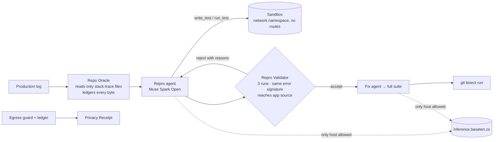

# Sentinel

**MIT licensed** · built from scratch for the Meta Global AI Developer Hackathon (Indie track, *Push the Frontier*), 3–4 Nov 2026 · solo: Charles Gourlaouen

> Drop in a production error log. Sentinel — an agent on Meta's **open-weight Muse Spark Open**, reading only the code the stack trace points to — hands back a test that fails for the *same reason*, a fix verified against the full suite, the commit that introduced the bug, and a **Privacy Receipt** proving the only network peer was the inference endpoint.

For teams whose code cannot go to a general-purpose cloud model.

## Quickstart (5 commands)

```bash
git clone https://github.com/charles-odasie/sentinel-meta && cd sentinel-meta
(cd apps/mqtt-sample && npm ci) && (cd packages/sentinel && npm ci)
export BASETEN_API_KEY=…            # Muse Spark Open on Baseten Model APIs (see .env.example for optional keys)
(cd packages/sentinel && npm run smoke)   # one chat call + one tool call, prints latency/usage, never prints keys
(cd packages/sentinel && npm run sentinel -- run --log ../../bench/bugs/B01/log.txt --repo ../../apps/mqtt-sample)
```

Outputs land in `packages/sentinel/sentinel-out/<timestamp>/`: `repro.spec.ts`, `fix.patch`, `privacy-receipt.md`, `result.json`, `transcript.json`.
Linux is required for the sandbox (`unshare -n`); elsewhere Sentinel still runs and the receipt says `sandbox: NONE`.

Run the benchmark (8 bugs × 3 configurations, resumable): `cd packages/sentinel && npm run bench`.

## How it works



1. **Repo Oracle** (`packages/sentinel/src/oracle.ts`) parses the stack trace and exposes *only* those files (plus imports expanded one hop per explicit request). Every read is recorded with its line range.
2. **Repro agent** — a tool-calling loop on Muse Spark Open: `read_file`, `expand_imports`, `write_test`, `run_test`, `finish`.
3. **Repro Validator** (`validator.ts`) accepts a test only if it fails 3/3 runs, each with the log's error class and (normalised) message, and the failure stack reaches application source. Rejections are fed back verbatim.
4. **Fix agent** edits in-scope source only; accepted only if the repro test passes *and* the whole suite is green. The patch is emitted as `fix.patch`.
5. **Bisect** — the validated test drives `git bisect run` between `good` and `bad`.
6. **Sandbox** — every test/git command runs under `unshare -n` (fresh network namespace: loopback only, no routes). A canary connect from inside must fail; the result is in the receipt.
7. **Egress guard** (`egress/ledger.ts`) hooks `net.Socket.prototype.connect` in the Sentinel process: any host not on the allow-list is destroyed before a byte is sent and logged as *blocked*.
8. **Privacy Receipt** — endpoints, models, allowed/blocked connections, exact file ranges disclosed, sandbox proof, and an explicit "proves / does not prove" section.

## Where Meta tooling is used

| Model | Served by | Role | Where |
|---|---|---|---|
| **Muse Spark Open** `meta-models/muse-spark-open` (open weights, 816B/42B MoE) | Baseten Model APIs `https://inference.baseten.co/v1` | all agentic reasoning: repro + fix | `src/config.ts`, `src/pipeline.ts` |
| **Muse Glimmer 30B** `accounts/fireworks/models/muse-glimmer-30b` (open weights) | Fireworks | fast steps (when `FIREWORKS_API_KEY` is set) | `src/config.ts` |
| Meta Model API `muse-spark-1.3` (hosted, not open-weight) | `https://api.meta.ai/v1` | configured fallback only; flagged in the receipt if used | `src/config.ts` |

The OpenAI-compatible endpoints are called with a single `fetch` (no SDK), so the egress guard sees exactly one host per provider.

## Benchmark

Target: `apps/mqtt-sample` — a NestJS IoT telemetry hub over an in-process MQTT broker (`aedes`), written for this hackathon, with 8 seeded bugs (`bench/bugs/B01–B08`: null-deref, wildcard logic, async race, boundary). Each bug has a patch, a trigger, a **real captured log**, ground truth, and a generated git history for bisect.

<!-- RESULTS:BEGIN -->
_Results are generated from `bench/results/<run>/results.json` and pasted here verbatim once the run completes._
<!-- RESULTS:END -->

Definitions: *reproduced* = Repro Validator accepted; *fixed* = repro passes + full suite green after the agent's edit; *suspect* = bisect names the true commit. Ablations: `no-validator` (first failing test accepted, checker run once post-hoc), `no-oracle` (unrestricted `list_dir`/`grep`/`read_file`).

## Privacy claim — exactly, with limits

**Proves:** (a) the Sentinel process opened TCP connections only to the allow-listed inference host(s) and blocked every other attempt before a byte left; (b) all test/git/trigger execution ran in a network namespace with no route out (canary connect fails); (c) the model received the log plus exactly the listed file ranges.

**Does not prove:** what the provider does with the bytes it received (Baseten documents zero-data-retention for this model — cited, not verified); anything about other processes on the host; resistance to hostile code *inside* Sentinel's own process (the hook is a guard against mistakes and SDK telemetry, not a security boundary). The stronger step is self-hosting the open weights — which is why open weights are the point.

## Built during the hackathon

The repository contained only `LICENSE` (29 Oct) before 3 Nov. Everything else is hackathon work:

| Component | Path | First commit |
|---|---|---|
| Sentinel core (client, egress guard, sandbox, Oracle, validator, fixer, bisect, receipt, CLI) | `packages/sentinel` | `c6b71a6` 3 Nov |
| PRD, plan, rules review | `docs/` | `c6b71a6`, `c9129b5` 3 Nov |
| Bench harness, CI | `packages/sentinel/src/bench`, `.github` | `985acb2` 3 Nov |
| Sample app + seeded bugs + histories | `apps/mqtt-sample`, `bench/` | _(pending)_ |
| Benchmark results | `bench/results/` | _(pending)_ |

AI coding assistance (Claude Code) was used throughout; design, decisions and verification are the author's.

## Roadmap
Self-hosted inference of the open weights (Modal) so the receipt's "does not prove" shrinks to nothing · languages beyond TypeScript/Jest · Docker/gVisor sandbox option · multi-file fixes with scope expansion policies · IDE integration.

## Docs
`docs/PRD_sentinel_meta.md` · `docs/02_plan.md` · `docs/00_current_state.md` · `docs/01_rules_compliance.md`

MIT © 2026 Charles Gourlaouen
