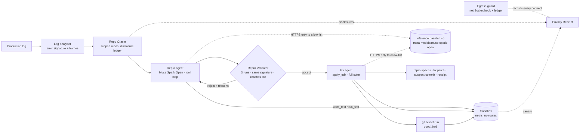

# Sentinel — PRD (Meta Global AI Developer Hackathon, Indie track, theme: Push the Frontier)

*Written Tue 3 Nov 2026 07:30 Bangkok. Deadline Wed 4 Nov 21:00 ET = Thu 5 Nov 09:00 Bangkok. Internal target: Tue 3 Nov 22:00 Bangkok (Charles's "end of day"), hard fallback Wed 4 Nov 22:00 Bangkok.*

## 1. Summary

**One line:** Drop in a production error log; Sentinel — running on Meta's open-weight Muse models, reading only the code the stack trace points to — hands back a failing test that fails for the *same reason*, a fix verified against the full suite, the commit that introduced it, and a Privacy Receipt proving nothing left the box except the model calls.

**Problem.** Teams whose code can't go to a general-purpose cloud model (regulated, air-gapped, IP-sensitive) still get production errors at 3 am. Today the loop is: read log → find code → guess a repro → write a test → bisect → fix. Agentic tools can do it, but they ship the whole repo to someone's cloud and you can't prove what they read or where it went.

**Target user / persona.** *Mina, staff engineer on a 6-person platform team at a mid-size IoT company.* Pager fires at 02:10 with a `TypeError` from the telemetry ingest service. She pastes the log into Sentinel on the on-call box. Eight minutes later she has a failing Jest test, a 3-line fix that keeps the suite green, the commit from last Tuesday that caused it, and a receipt she can attach to the incident ticket showing exactly which 140 lines of code the model saw and that the only network peer was the company's inference endpoint.

**Why it wins under the rubric** (weights `UNVERIFIED`, from the brief):

| Criterion | Weight | What maps to it |
|---|---|---|
| Impact | 30% | Real, daily pain (repro + bisect + fix); the privacy receipt makes agentic debugging admissible where it is banned today |
| Use of Meta AI tooling | 25% | All reasoning on **Muse Spark Open** (open weights, Baseten); fast steps on **Muse Glimmer 30B** (Fireworks); model names on screen in every run and in the receipt; open-weight path = self-hostable, which is the whole privacy story |
| Demo | 25% | A 3-minute live run: log in → failing test → validator rejects a wrong-reason test on camera → fix → bisect names the commit → receipt. Visible, verifiable, no slides |
| Technical depth & execution | 20% | Repro Validator (same-reason + determinism + source-reaching), Repo Oracle disclosure ledger, kernel-level netns sandbox with canary, measured benchmark with ablations |
| Bonus: Open-Weight ($10K), Agentic ($5K) | — | Open-weight-only primary path; a genuine tool-calling agent loop with verification gates |

## 2. Scope

**MUST (ship by Tue 22:00 BKK)**
- `sentinel run --log --repo` CLI: Repo Oracle → repro agent → Repro Validator → fix agent + full-suite verification → bisect → Privacy Receipt (md + json). ✅ built (`packages/sentinel`), unverified against a live model.
- In-repo benchmark target: NestJS + MQTT "telemetry-hub" (in-process `aedes` broker), green Jest suite, **8 seeded bugs** across 4 classes with real captured logs, per-bug synthetic git history for bisect. (in progress)
- Benchmark harness: 8 bugs × 3 configs (full / no-validator / no-oracle) → `bench/results/<run>/results.{json,md}`: % reproduced, % fixed, % correct suspect, median minutes, tokens and $ per bug. **Only measured numbers go in the README.**
- README: MIT at top, ≤5 setup commands, where each Meta tool is used, "built during the hackathon" table with first-commit dates, results, privacy claim + limits, roadmap. `.env.example`. CI (typecheck + unit tests + forbidden-name grep, no model calls).
- Smoke test script (one chat + one tool call per provider).
- 3-minute demo video + submission text (`docs/private/04_submission_meta.md`).

**SHOULD (if time after MUST)**
- Fast-model routing actually used (Glimmer for log triage/summary) rather than configured-only.
- Benchmark run twice to report run-to-run variance.
- Ablation "no-sandbox" line in the receipt to show the canary failing.

**WON'T (say so in README roadmap)**
- UI / web app. Languages other than TypeScript/Jest. Docker-based sandbox. Multi-file fixes beyond what the Oracle scope allows. Self-hosting the weights (documented as the next step; Modal credits make it feasible post-hackathon). 20 bugs (cut to 8 — reason: 50 h window, solo, each bug needs a real log, a patch, a history and ~3 benchmark runs).

## 3. User flow and demo storyboard (3:00)

| t | On screen | Voice |
|---|---|---|
| 0:00–0:15 | Terminal. `cat bench/bugs/B03/log.txt` — a real stack trace from the telemetry service | "This is a production error from an MQTT telemetry service. The code can't leave the box." |
| 0:15–0:30 | `sentinel run --log bench/bugs/B03/log.txt --repo work/B03 --history work/B03-history`. Header prints **reasoner: meta-models/muse-spark-open @ inference.baseten.co (open weights)**, allow-list, **sandbox canary: PASS — connect 1.1.1.1:443 inside netns → ERR ENETUNREACH** | "Sentinel runs on Meta's open-weight Muse Spark Open via Baseten. Before it starts, it proves the sandbox: from inside, the internet is unreachable." |
| 0:30–1:05 | Repo Oracle lines: `in-repo frames: 2/9 → src/telemetry/telemetry-parser.service.ts:41, src/ingest/ingest.service.ts:88`. Tool calls scroll: `read_file`, `expand_imports`, `write_test`, `run_test → exit 1, first error: TypeError…` | "It reads only the files in the stack trace — every byte it sees is ledgered. The agent writes a Jest test and runs it in the sandbox." |
| 1:05–1:35 | **Validator REJECTED** — "wrong reason: error class differs: log says TypeError, test threw AssertionError" → agent rewrites → **Validator ACCEPTED — failed 3/3 runs with the production error signature; stack reaches application source** | "Here's the part that matters: the first test failed for the wrong reason. The Repro Validator rejected it. The second one fails three times out of three with exactly the logged error, inside application code." |
| 1:35–2:05 | Fix stage: `apply_edit`, `run_repro_test → exit 0`, `run_full_suite → exit 0`, **fix: VERIFIED**. `cat fix.patch` (3 lines) | "Then it proposes the smallest fix and verifies it against the whole suite." |
| 2:05–2:25 | `bisect → a1b2c3d "tighten payload handling" after 3 steps` and `git show --stat a1b2c3d` | "The failing test drives git bisect: that's the commit that shipped the bug." |
| 2:25–2:50 | `cat privacy-receipt.md`: endpoints table (model, open weights: yes), **Blocked attempts: none / allowed: inference.baseten.co:443 ×14**, files disclosed with line ranges, sandbox canary, "proves / does not prove" | "The Privacy Receipt: one host, these 140 lines, nothing else. And it says what it can't prove — a hosted endpoint still sees what you send; the weights are open, so the next step is your own box." |
| 2:50–3:00 | README results table (real numbers) + repo URL | "Eight seeded bugs, three configurations, measured. Sentinel. MIT. Built this week on Muse." |

Fallback if the live run misbehaves on camera: record two takes; the storyboard uses the real terminal output of a benchmark run (not staged text).

## 4. Architecture



**Components** (all in `packages/sentinel/src`):
- `oracle.ts` — parses `at fn (file:line:col)` frames, drops `node:`/`node_modules`, resolves to repo files by suffix. Scope = frame files + sibling spec (for conventions) + imports expanded one hop per explicit tool call. Every read is recorded `{path, from, to, bytes, why}`. Ablation `scoped=false` adds `list_dir`/`grep`.
- `agent/loop.ts` — OpenAI-compatible tool loop; sequential tool execution; one nudge when the model answers in prose; `resume` to continue after validator feedback.
- `validator.ts` — accept iff: 3/3 runs fail; each first error line matches the log signature (same class; normalised message equal or Jaccard ≥ 0.6); failure stack contains an application-source frame (not only the spec); no compile/load failure. Rejections are fed back verbatim.
- `pipeline.ts` fix stage — `apply_edit` only on in-scope non-test files; accept iff repro passes **and** full suite green **and** ≥1 file edited; patch produced with `git diff --no-index`; tree restored if unverified.
- `bisect.ts` — writes the test untracked, `git bisect start bad good`, `git bisect run` a script that runs that one Jest file; parses "first bad commit".
- `egress/ledger.ts` — wraps `net.Socket.prototype.connect` (fetch/undici, http, tls all pass through it). Allow-list = hosts of the configured providers. Off-list → socket destroyed before connect, attempt recorded as BLOCKED. Unit-tested (`fetch('https://example.com')` is blocked).
- `sandbox.ts` — every child command runs under `unshare -n` (new netns: loopback only, no routes). Loopback is brought up with `ip` or a Python `ioctl` fallback (minimal containers lack `ip`). Canary: a `node` connect to `1.1.1.1:443` from inside must fail. If netns is unavailable the receipt says `sandbox: NONE`.
- `egress/receipt.ts` — JSON + Markdown.

**The privacy claim, exactly.** *Sentinel proves (a) its own process opened TCP connections only to the allow-listed inference host(s) and blocked every other attempt before a byte was sent; (b) all test/git/trigger execution happened in a network namespace with no route out, demonstrated by a failed canary connect; (c) the model received the log plus exactly the listed file ranges.* **It does not prove** what the provider does with received bytes (Baseten documents ZDR for this model — cited, not verified), anything about other processes on the host, or resistance to hostile code inside Sentinel's own process (the hook is a guard against mistakes and SDK telemetry, not a security boundary). The honest stronger step is self-hosting the open weights; that is the roadmap item and why open weights matter here.

## 5. Model plan

| Role | Model | Endpoint | Why |
|---|---|---|---|
| reasoner (repro, fix) | `meta-models/muse-spark-open` | Baseten `https://inference.baseten.co/v1` | open weights (bonus + privacy story), tool calling + reasoning supported, 1M ctx |
| fast (triage, summaries) | `accounts/fireworks/models/muse-glimmer-30b` | Fireworks `https://api.fireworks.ai/inference/v1` | open weights, cheap; falls back to reasoner when no key |
| fallback | `muse-spark-1.3` | Meta Model API `https://api.meta.ai/v1` | hosted, **not** open-weight; used only if Baseten is down, and flagged in the receipt |

- **Prompts**: `pipeline.ts` — one system prompt per stage (repro / fix), first user turn = log (≤12 KB) + frame windows (±30 lines top frame, ±15 others) + one sibling spec (60 lines) for conventions.
- **Tools** (repro): `read_file`, `expand_imports`, `write_test`, `run_test`, `finish` (+ `list_dir`, `grep` in the no-oracle ablation). (fix): `read_file`, `expand_imports`, `apply_edit`, `run_repro_test`, `run_full_suite`, `finish`.
- **Routing rules**: `SENTINEL_REASONER` / `SENTINEL_FAST` env; defaults as above; the allow-list is derived from the chosen providers so the guard and the router can't disagree.
- **Budgets**: repro ≤10 turns + ≤3 validator rounds × 6 turns; fix ≤12 turns; `max_tokens` 4096/turn; tool outputs truncated at 24 KB, Jest output trimmed to failure blocks. Expected ≈ 15–30 requests, 60–150K prompt tokens, 5–15K completion tokens per bug → **≈ $0.10–0.25 per bug on Baseten** (to be replaced by measured numbers).
- **Retries**: 5, exponential backoff capped at 30 s, honours `Retry-After`; on 429/5xx/529 only.
- **Determinism**: `temperature: 0`; Baseten states this does not guarantee reproducibility for this model, so *determinism is enforced on the artefact, not the model* — the validator runs the test 3× and the benchmark reports variance if run twice.
- **Known constraints**: Baseten: no JSON mode / structured outputs for this model, `n>1` → 400 (we use neither). Meta Model API: `tool_choice` only `"auto"` (we send only `"auto"`).

## 6. Benchmark plan

- **Sample app**: `apps/mqtt-sample` (telemetry-hub) — NestJS services (topic matcher, telemetry parser, device registry, alert rules, retained state, ingest) over an in-process `aedes` broker; Jest suite green; MIT; written this week.
- **Bugs**: `bench/bugs/B01..B08`, classes `null-deref`, `wildcard-logic`, `async-race`, `boundary`; each: `bug.patch` (introduces), `trigger.ts`, `log.txt` (captured by really running the buggy code), `truth.json` (`file`, `lines`, `error_signature`, `caught_by_existing_test`).
- **Ground truth for bisect**: `bench/scripts/make-history.sh B0X <dir>` builds a repo `good → noise×4–6 → bug → noise×2–3 → bad`; prints the bug SHA.
- **Metrics per (bug, config)**: `reproduced` = validator-accepted test (for no-validator config the same checker is run post-hoc, not fed back); `fixed` = repro passes + full suite green; `suspect_correct` = bisect SHA == truth SHA; `minutes`; `prompt/completion tokens`; `usd` (Baseten list price; Fireworks price `UNVERIFIED` → reported as tokens only).
- **Configs**: `full`, `no-validator`, `no-oracle`. Order: all bugs on `full` first (the demo and headline numbers), then ablations.
- **Protocol**: fresh work copy per run (clean app + `git apply` patch; `node_modules` symlinked), serial, 20-min timeout per run; results appended to `bench/results/<run-id>/results.json` as they finish so a crash loses nothing; `results.md` regenerated from JSON.
- **Claims**: only measured numbers, with N, in README and submission. If a config fails everywhere, say so.

## 7. Repo plan

```
LICENSE (MIT)            README.md            .env.example        .github/workflows/ci.yml
packages/sentinel/       CLI + agent (TypeScript, tsx, vitest)
apps/mqtt-sample/        NestJS + MQTT benchmark target (Jest)
bench/bugs/B01..B08/     patch · trigger · log · truth      bench/scripts/   make-history.sh · verify-bugs.sh
bench/results/<run>/     results.json · results.md · per-run receipts (work/ dirs gitignored)
docs/                    00 current state · 01 rules · PRD · 02 plan (public)    docs/private/ (gitignored: 03 credits, 04 submission)
```
README outline: badge-free title + MIT line → one-paragraph pitch → 60-second quickstart (`git clone`, `npm ci` ×2, `export BASETEN_API_KEY=…`, `npm run sentinel -- run …`) → how it works (diagram) → where each Meta tool is used → benchmark results (real) → privacy claim and limits → built during the hackathon (table) → roadmap → AI-assistance disclosure.
CI: `npm ci && npm run typecheck && npm test` for both packages + `grep -ri` forbidden names → fail. No model calls in CI.

## 8. Task breakdown (riskiest first) — owner: 🤖 = this session, 👤 = Charles

| # | Task | Est | Depends on | Owner | Status |
|---|---|---|---|---|---|
| 1 | Model smoke test: tool-calling works on Muse Spark Open via Baseten | 0.2 h | **API key secret** | 👤 key → 🤖 | blocked |
| 2 | Sample app + 8 bugs + histories, verified | 2.5 h | — | 🤖 (subagent) | running |
| 3 | Sentinel core | 2 h | — | 🤖 | ✅ |
| 4 | First end-to-end run on one bug; prompt fixes | 1.5 h | 1, 2 | 🤖 | — |
| 5 | Bench harness + run `full` on 8 bugs | 2 h | 4 | 🤖 | — |
| 6 | Ablations (16 runs) | 2 h | 5 | 🤖 | — |
| 7 | README + CI + .env.example + results | 1 h | 5 | 🤖 | — |
| 8 | PRD/plan/credits/submission docs | 1 h | — | 🤖 | in progress |
| 9 | Demo video (record 2 takes, trim, upload) | 1.5 h | 5 | 👤 (script from 🤖) | — |
| 10 | Submission form + X post | 0.5 h | 7, 9 | 👤 | — |
| — | **Cut line** — below here only if ahead of schedule | | | | |
| 11 | Glimmer actually used for triage | 0.5 h | 1 | 🤖 | — |
| 12 | Second benchmark pass for variance | 1.5 h | 6 | 🤖 | — |

## 9. Risks and mitigations

| Risk | Likelihood | Mitigation |
|---|---|---|
| **No API key in this session** (secrets land in new sessions) | high today | Everything else is built key-free; smoke test is a one-command script; if needed Charles opens a new session on `main` with "continue from docs/02_plan.md" |
| Muse Spark Open tool-calling quality (malformed args, prose instead of tools) | medium | Loop tolerates invalid JSON, nudges once, truncates outputs; validator feedback is concrete; fallback `muse-spark-1.3` on Meta API is one env var away and is flagged honestly |
| Rate limits / 429 on Baseten (2M TPM promised to "select participants") | medium | Serial runs, backoff with `Retry-After`, ≤30 requests per bug; benchmark resumable per (bug, config) |
| Credit exhaustion | low | ≈ $0.25/bug × 24 runs ≈ $6 expected; set a Baseten spend alert (runbook) |
| Non-determinism of model | certain | Enforced at artefact level (3× validator runs); report variance if a second pass fits |
| Sandbox claim over-reach | medium | Claim text in receipt lists what is *not* proven; netns + canary are kernel-level facts; the in-process hook is described as a guard, not a boundary |
| Bisect fails to converge (flaky test across history) | low | Noise commits are tiny and keep the suite green; the validator already required 3× stable failure |
| Deadline | high | MUST list is small; cut line in §8; internal target Tue 22:00 BKK leaves a full day of buffer |
| Video production | medium | Storyboard is the real terminal output; two takes; no editing beyond trimming |
| "New work" identification | low | Repo history starts Oct 29 with a LICENSE; README table of components with first-commit SHAs |

## 10. Acceptance criteria / definition of done

- [ ] `npm run smoke` shows a successful chat and tool call on `meta-models/muse-spark-open` (latency + usage printed).
- [ ] `sentinel run` on ≥1 seeded bug produces: validator-accepted `repro.spec.ts`, verified `fix.patch`, correct suspect commit, `privacy-receipt.md` with **blocked attempts: none / allowed: inference host only** and **canary PASS**.
- [ ] Benchmark: 8 bugs × 3 configs run; `results.md` committed; README table equals `results.json`.
- [ ] CI green on `main` (typecheck, unit tests, forbidden-name grep); no secrets in repo (`git grep -iE 'sk-|api[_-]?key\s*=\s*\S{8}'` clean except `.env.example`).
- [ ] README: MIT visible at top, setup ≤5 commands from a clean clone (verified in a fresh directory), Meta tools section, hackathon-built table, privacy claim + limits, roadmap, disclosure.
- [ ] Video ≤3:00, public/unlisted, no login; link opens in a private window.
- [ ] Submission fields filled from `docs/private/04_submission_meta.md`; X post published; links verified in a private window.
- [ ] No employer/customer names anywhere (`grep` in CI).
